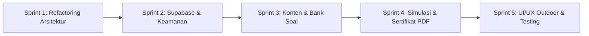

# AUDIT ROOVEYLEARN — LAPORAN EVALUASI & PENYEMPURNAAN SISTEM

Tanggal Audit: 17 Oktober 2026  
Auditor: Senior Flutter Engineer & UI/UX Reviewer  
Dokumen Acuan: `PROPOSAL ROOVEYLEARN.md` (Source of Truth)  
Status Repositori: Prototipe Aktif (Branch `main`, commit `cc6fbfc`)

---

## 1. Ringkasan Eksekutif

RooveyLearn saat ini berada pada tahap **prototipe fungsional lokal (High-Fidelity UI Prototype)** dengan visual *Coastal Editorial* yang menarik dan komponen interaktif yang berjalan mulus di perangkat Android. Namun, terdapat **kesenjangan arsitektural dan teknis yang sangat signifikan** terhadap spesifikasi proposal. Seluruh kode aplikasi (3.280 baris) masih tertumpuk dalam satu file monolitik (`lib/main.dart`), backend Supabase dan basis data PostgreSQL (8 tabel) **belum diintegrasikan sama sekali** (100% bergantung pada `shared_preferences` lokal), kunci jawaban kuis terekspos di sisi klien, materi 5 modul masih berupa ringkasan *placeholder* 2–3 kalimat, dan soal pre-test sama persis dengan post-test. Diperlukan refaktorisasi arsitektur bertahap (pemecahan modul layer) serta integrasi backend tanpa merusak keindahan UI prototipe yang sudah ada.

### Skor Kematangan Sistem (Skala 1–10)

| Kategori | Aspek Evaluasi | Skor | Keterangan Singkat |
| :--- | :--- | :---: | :--- |
| **A** | Kesesuaian Fitur terhadap Proposal | **5 / 10** | Alur navigasi ada, tetapi backend Supabase & kuis modul belum ada. |
| **B** | Kualitas Kode dan Arsitektur | **3 / 10** | Monolitik 3.280 baris di `lib/main.dart`, belum ada layer folder. |
| **C** | Keamanan dan Backend | **2 / 10** | Supabase belum ada; kunci jawaban & evaluasi kuis terbuka di klien. |
| **D** | UI/UX dan Konsistensi Visual | **8 / 10** | Estetika tema Stitch konsisten; perlu perbaikan kontras luar ruangan. |
| **E** | Keandalan (Reliability) | **6 / 10** | State lokal tertangani baik, namun belum ada handling offline sync/network. |
| **F** | Performa | **6 / 10** | CustomPainter animasi loop berpotensi boros baterai pada ponsel entry-level. |
| **G** | Aksesibilitas & Target Pengguna | **5 / 10** | Bahasa komunikatif, namun kontras teks kecil rendah & minim glosarium. |
| **H** | Kualitas Konten Pembelajaran | **3 / 10** | Materi 5 modul sangat ringkas (dummy), bank soal terbatas (5 butir). |
| **I** | Pengujian dan Dokumentasi | **3 / 10** | Hanya 1 unit test lokal (auth hash); 0% widget/integration test. |
| **RATA-RATA** | **Indeks Kesiapan Produksi (MVP)** | **4.5 / 10** | **Prototipe UI Siap, Fondasi Arsitektur Perlu Restrukturisasi** |

---

## 2. Tabel Status Fitur

Berdasarkan komparasi antara dokumen `PROPOSAL ROOVEYLEARN.md` dengan source code saat ini:

| No | Fitur / Spesifikasi | Status Proposal | Status Kode | Bukti Implementasi (File:Baris) | Catatan Kritis |
| :---: | :--- | :--- | :--- | :--- | :--- |
| 1 | **Stack Teknologi: Flutter + Dart** | Wajib | **LENGKAP** | `pubspec.yaml:6-12` | Flutter 3.47.5, Dart 3.13.4 berjalan dengan baik. |
| 2 | **Backend: Supabase (Auth, DB 8 Tabel)** | Wajib | **BELUM ADA** | `pubspec.yaml:9-14`, `lib/main.dart:1-8` | Package `supabase_flutter` tidak ada di dependencies; digantikan SharedPreferences. |
| 3 | **Pemisahan Arsitektur 3 Lapisan** | Wajib | **BERMASALAH** | `lib/main.dart:1-3280` | Folder `pages/`, `widgets/`, `services/`, `repositories/` belum dibuat. |
| 4 | **Autentikasi (Registrasi & Login)** | Wajib | **SEBAGIAN** | `lib/main.dart:30-118, 736-1044` | Berfungsi secara lokal (PBKDF2 SHA-256), tapi tidak ada sinkronisasi server/cloud. |
| 5 | **Profil Pengguna** | Wajib | **SEBAGIAN** | `lib/main.dart:20-28, 1046-1158` | Hanya simpan nama, email, created_at lokal. Belum ada asosiasi komunitas pesisir. |
| 6 | **Mode Tamu (Guest Mode)** | Tidak ada di proposal | **LENGKAP** | `lib/main.dart:427-431, 713-718` | Pengguna bisa "Jelajah tanpa akun", namun progres tersimpan di memori perangkat. |
| 7 | **Navigasi Utama 4 Tab** | Wajib | **LENGKAP** | `lib/main.dart:622-651` | Beranda, Jelajah, Belajar, Progres tertata rapi dalam `NavigationBar`. |
| 8 | **Dashboard Pembelajaran** | Wajib | **LENGKAP** | `lib/main.dart:1377-1542` | Menampilkan progres modul aktual, XP, kartu jelajah, dan akses pre-test. |
| 9 | **Pre-Test** | Wajib | **SEBAGIAN** | `lib/main.dart:504-517, 2582-2701` | Berfungsi menyimpan skor awal, tapi soalnya sama persis dengan kuis akhir (post-test). |
| 10 | **5 Modul Pembelajaran Terstruktur** | Wajib | **DUMMY** | `lib/main.dart:1190-1291` | Struktur 5 modul ada, namun materi hanya ringkasan teks 1 paragraf (30-40 kata). |
| 11 | **Kuis per Modul** | Wajib | **BELUM ADA** | `lib/main.dart:2398-2486` | Di akhir modul hanya ada 1 pertanyaan *single checkpoint*, bukan kuis modul terpisah. |
| 12 | **Simulasi Pengambilan Keputusan** | Wajib (MVP) | **LENGKAP** | `lib/main.dart:2492-2560` | Skenario assessment rehabilitasi pesisir + feedback + reward XP (+15/+5). |
| 13 | **Simulasi Pengurutan Langkah Tanam** | Wajib | **LENGKAP** | `lib/main.dart:2837-2905` | Drag-and-drop 4 langkah tanam zona pasang surut + validasi + koreksi. |
| 14 | **Simulasi Diagnostik Urutan Kerja** | Wajib | **LENGKAP** | `lib/main.dart:2907-2962` | Multiselect langkah salah posisi + feedback edukatif koreksi prosedur. |
| 15 | **Simulasi Kalibrasi Refraktometer** | Wajib | **LENGKAP** | `lib/main.dart:2964-3014` | Visual instrumen lingkaran air pori + slider offset (-5 s.d +5) + verifikasi 32 PSU. |
| 16 | **Pencatatan Riwayat Simulasi (DB)** | Wajib | **BELUM ADA** | `lib/main.dart:2837-3014` | Aktivitas 13, 14, 15 tidak menyimpan riwayat attempt dan tidak menambah XP. |
| 17 | **Jelajah Interaktif (Virtual Explorer)** | Wajib | **LENGKAP** | `lib/main.dart:1794-1927` | 5 hotspot ekosistem dengan modal bottom sheet penjelas fungsi biota/akar/sedimen. |
| 18 | **Asesmen Akhir (Post-Test)** | Wajib | **SEBAGIAN** | `lib/main.dart:519-540, 2582-2701` | Berfungsi jika 5 modul tuntas, tetapi hanya 5 soal yang di-hardcode di klien. |
| 19 | **Sertifikat Digital (Syarat >= 80%)** | Wajib | **LENGKAP** | `lib/main.dart:360-369, 3153-3204` | Syarat kelulusan >= 80% & 5 modul tuntas divalidasi; nomor ID unik otomatis terbit. |
| 20 | **Ekspor / Unduh Sertifikat (PDF/PNG)** | Fitur Wajar | **BELUM ADA** | `lib/main.dart:3164-3204` | Hanya kartu preview visual di layar; tidak ada tombol simpan PDF atau share WA. |
| 21 | **Row Level Security (RLS) & DB Security**| Wajib | **BELUM ADA** | N/A | Karena Supabase belum dihubungkan, RLS belum ada. |
| 22 | **Kerahasiaan Kunci Jawaban di Server** | Wajib | **BERMASALAH** | `lib/main.dart:1207, 2575-2579, 2854`| Kunci jawaban dapat dibaca langsung di source code client. |

---

## 3. Daftar Temuan Berdasarkan Prioritas

### PRIORITAS P0: Bug Kritis, Keamanan, Integritas Data & Arsitektur Utama
*Kategori: Harus diselesaikan sebelum rilis prototipe fungsional.*

#### [P0-01] Backend Supabase dan 8 Tabel Database Belum Diintegrasikan Sama Sekali
- **Deskripsi**: Proposal Bab III (3.4) dan Bab IV (4.1) menetapkan Supabase (PostgreSQL, Supabase Auth, Storage) sebagai backend utama dengan 8 tabel (`profiles`, `learning_modules`, `learning_materials`, `quiz_questions`, `assessment_results`, `user_module_progress`, `simulation_attempts`, `certificates`). Saat ini, aplikasi 100% menggunakan `shared_preferences` lokal tanpa package `supabase_flutter`.
- **Dampak**: Tidak ada sinkronisasi antarperangkat, data hilang saat cache dihapus atau aplikasi di-uninstall, tidak dapat memantau peserta oleh fasilitator, dan melanggar spesifikasi proposal.
- **Lokasi**: `pubspec.yaml:9-14`, `lib/main.dart:1-8, 30-118`.
- **Saran Perbaikan**:
  1. Tambahkan `supabase_flutter: ^2.8.0` ke `pubspec.yaml`.
  2. Buat skema migrasi SQL di Supabase mencakup 8 tabel tersebut.
  3. Konfigurasi `Supabase.initialize()` menggunakan `anonKey` dan `url` melalui `flutter_dotenv` (`.env`).
  4. Ganti `LocalAccountStore` dengan layanan Supabase Auth dan Repository terstruktur.
- **Estimasi Usaha**: **L (Large)**

#### [P0-02] Kunci Jawaban Kuis & Logika Kelulusan Sepenuhnya Terekspos di Sisi Klien
- **Deskripsi**: Kunci jawaban soal kuis akhir (`quizQuestions[i].correct`), jawaban modul (`learningModules[i].correctAnswer`), dan urutan benar simulasi (`_correctPlantingSteps`) disimpan sebagai konstanta publik di memori aplikasi Android. Evaluasi kelulusan (skor >= 80%) dilakukan murni di klien (`percentage >= 80`).
- **Dampak**: Pengguna dengan pengetahuan teknis dapat membongkar (reverse engineer) APK atau memanipulasi local storage untuk memalsukan nilai 100% dan menerbitkan sertifikat tanpa belajar. Melanggar Bab 3.4 poin 4 proposal.
- **Lokasi**: `lib/main.dart:1207, 1227, 1247, 1267, 1287, 2575-2579, 2675, 3034`.
- **Saran Perbaikan**:
  1. Jangan kirim kolom `correct_answer` ke klien saat mengambil daftar soal dari Supabase.
  2. Buat Supabase Database Function / RPC (misal `submit_quiz_answers(user_id, answers_payload)`) untuk menghitung skor di server secara terisolasi dan mencatat ke tabel `assessment_results`.
  3. Sertifikat hanya di-*generate* melalui database trigger / RPC jika data `assessment_results` tervalidasi >= 80%.
- **Estimasi Usaha**: **M (Medium)**

#### [P0-03] Arsitektur Monolitik 1 File (`lib/main.dart` 3.280 Baris)
- **Deskripsi**: Seluruh UI, model, logika state, CustomPainter, dan data dummy diletakkan dalam satu file tanpa pemisahan modul layers.
- **Dampak**: *Spaghetti code*, risiko regresi sangat tinggi ketika diedit, sulit diuji (*untestable*), melanggar prinsip *Clean Architecture* dan spesifikasi struktur proposal Bab IV (4.2).
- **Lokasi**: `lib/main.dart:1-3280`.
- **Saran Perbaikan**:
  Pecah menjadi struktur modular:
  - `lib/core/` (theme, constants, utils, network)
  - `lib/models/` (`module.dart`, `quiz.dart`, `profile.dart`, `simulation.dart`, `certificate.dart`)
  - `lib/services/` (`supabase_service.dart`, `auth_service.dart`)
  - `lib/repositories/` (`module_repository.dart`, `progress_repository.dart`)
  - `lib/pages/` (`home/`, `explore/`, `learn/`, `progress/`, `quiz/`, `simulation/`, `auth/`)
  - `lib/widgets/` (`mangrove_scene.dart`, `cards/`, `buttons/`, `banners/`)
- **Estimasi Usaha**: **L (Large)**

---

### PRIORITAS P1: Fitur Inti Kurang / Tidak Sesuai Proposal
*Kategori: Harus diselaraskan agar fungsi akademik & edukatif tercapai.*

#### [P1-01] Soal Pre-Test Memakai Soal yang Sama Persis dengan Kuis Akhir (Post-Test)
- **Deskripsi**: Baik `_openPreTest()` maupun `_openQuiz()` memanggil `QuizScreen` dengan kumpulan data yang sama persis: `quizQuestions` (5 butir).
- **Dampak**: Ujian awal membocorkan seluruh pertanyaan dan kunci jawaban kuis akhir. Pengukuran peningkatan pemahaman (*Learning Improvement* / Bab 4.3.6) menjadi bias dan tidak valid secara metodologi edukasi.
- **Lokasi**: `lib/main.dart:508-515, 528-537, 2574-2580, 2618`.
- **Saran Perbaikan**:
  Pisahkan bank soal:
  1. Kumpulan soal Pre-Test (5-10 butir pengenalan awal).
  2. Kuis formatif per modul (3-5 butir di tiap modul).
  3. Kumpulan soal Asesmen Akhir (Post-Test acak 10 butir dari bank soal terverifikasi).
- **Estimasi Usaha**: **M (Medium)**

#### [P1-02] Kuis per Modul Belum Ada (Hanya 1 Pertanyaan Checkpoint Singkat)
- **Deskripsi**: Proposal Bab 3.1 & 4.3.6 mensyaratkan setiap modul memiliki kuis evaluasi pemahaman tersendiri (menampilkan nilai, jumlah benar, status lulus, dan pembahasan). Saat ini hanya ada 1 butir pertanyaan checkpoint interaktif di dalam `LessonScreen`.
- **Dampak**: Pengguna menyelesaikan modul hanya dengan menebak 1 soal; tidak ada evaluasi komprehensif materi per modul.
- **Lokasi**: `lib/main.dart:2442-2477`.
- **Saran Perbaikan**: Setelah halaman materi modul selesai, arahkan pengguna ke layar kuis modul khusus (3–5 soal) yang mencatat nilai modul ke tabel `user_module_progress`.
- **Estimasi Usaha**: **M (Medium)**

#### [P1-03] Konten Pembelajaran 5 Modul Masih Berupa Dummy Placeholder
- **Deskripsi**: Isi modul di `learningModules` hanya berupa 1 paragraf ringkas (30-40 kata) tanpa sub-bab, tanpa media visual foto/video/animasi nyata, dan tanpa rujukan ilmiah.
- **Dampak**: Aplikasi belum dapat berfungsi sebagai media edukasi mandiri yang riil bagi masyarakat pesisir sesuai Bab 4.3.3.
- **Lokasi**: `lib/main.dart:1190-1291`.
- **Saran Perbaikan**: Siapkan konten markdown/JSON terstruktur yang mencakup sub-materi (teks terstruktur, poin penting, panduan lapangan, dan ilustrasi SVG/gambar WebP ringan).
- **Estimasi Usaha**: **L (Large)**

#### [P1-04] Simulasi Lapangan Tidak Menyimpan Riwayat Percobaan ke Database
- **Deskripsi**: Tiga aktivitas lapangan baru (`PlantingSequenceScreen`, `SequenceDiagnosticScreen`, `RefractometerCalibrationScreen`) tidak menyimpan status atau riwayat percobaan ke penyimpanan apa pun (`DESIGN_IMPLEMENTATION_NOTES.md:22`).
- **Dampak**: Data tabel `simulation_attempts` (Bab 3.4 poin 7) kosong; progres simulasi tidak terukur.
- **Lokasi**: `lib/main.dart:2837-3014`.
- **Saran Perbaikan**: Berikan callback hasil simulasi ke `_AppShellState` atau Service, simpan log percobaan (skor, status benar/salah, timestamp) ke tabel `simulation_attempts` dan berikan reward XP yang proporsional.
- **Estimasi Usaha**: **S (Small)**

---

### PRIORITAS P2: Kualitas Kode, UI/UX, dan Keandalan (Reliability)

#### [P2-01] 23 Isu Analisis Linting (`deprecated_member_use` & `prefer_const_constructors`)
- **Deskripsi**: `flutter analyze` menghasilkan 23 peringatan. 12 di antaranya adalah penggunaan `.withOpacity(...)` yang telah didepresiasi pada Flutter versi terbaru (digantikan oleh `.withValues(alpha: ...)`), serta 11 konstruktor widget yang kehilangan `const`.
- **Dampak**: Menurunkan skor kualitas kode, memicu potensi *precision loss* warna, dan *overhead* alokasi objek widget.
- **Lokasi**: `lib/main.dart:1497, 1560, 1562, 1989, 2046, 2060, 2083, 2110, 2147, 2180, 2238, 2265, 2317, 2528, 2998`.
- **Saran Perbaikan**: Jalankan refaktor otomatis dan ganti `.withOpacity(x)` menjadi `.withValues(alpha: x)`, serta tambahkan kata kunci `const`.
- **Estimasi Usaha**: **S (Small)**

#### [P2-02] Kontras Warna Teks Rendah untuk Penggunaan Lapangan (Outdoor Readability)
- **Deskripsi**: Warna `muted` (`#6E6E73`) dengan ukuran font 9–11px pada latar belakang `sand` (`#F5F5F7`) hanya memiliki rasio kontras ~3.5:1 (di bawah standar WCAG AA 4.5:1 untuk teks kecil).
- **Dampak**: Sulit dibaca oleh masyarakat pesisir di luar ruangan (pantai/tambak) di bawah terik sinar matahari.
- **Lokasi**: `lib/main.dart:1442, 1472, 1535, 1758, 2387, 2736, 3063, 3181`.
- **Saran Perbaikan**: Naikkan kontras teks sekunder menjadi minimal `#4A5553` dan hindari penggunaan font di bawah 11sp untuk informasi instruksional.
- **Estimasi Usaha**: **S (Small)**

#### [P2-03] Potensi Boros Baterai / Rebuild Berlebih dari Animasi Tak Henti `MangroveScene`
- **Deskripsi**: `_animation = AnimationController(vsync: this, duration: const Duration(seconds: 8))..repeat();` berjalan terus-menerus memicu repaint CustomPainter 60fps sekalipun halaman tidak sedang aktif bergerak.
- **Dampak**: Menghabiskan daya baterai secara cepat pada smartphone entry-level masyarakat pesisir.
- **Lokasi**: `lib/main.dart:1946-1960`.
- **Saran Perbaikan**: Hentikan (`stop()`) animasi saat widget tidak terlihat di layar (gunakan `VisibilityDetector` atau `TickerMode.of(context)`).
- **Estimasi Usaha**: **M (Medium)**

#### [P2-04] Belum Ada Penanganan State Ketiadaan Sinyal / Error Network
- **Deskripsi**: Aplikasi belum memiliki komponen *Network Error State*, *Offline Indicator*, atau *Retry Mechanism*.
- **Dampak**: Ketika Supabase dihubungkan nanti, jika pengguna berada di area pesisir dengan sinyal lemah/hilang, aplikasi akan freeze atau menampilkan error mentah.
- **Lokasi**: `lib/main.dart:327-400`.
- **Saran Perbaikan**: Terapkan arsitektur *Offline-First* (caching dengan Hive / SQLite lokal) sehingga materi yang sudah diunduh tetap bisa dibuka tanpa sinyal, dan sinkronisasi dilakukan di latar belakang saat online.
- **Estimasi Usaha**: **M (Medium)**

#### [P2-05] State Management Props Drilling Tanpa State Container Terpusat
- **Deskripsi**: `_AppShellState` meneruskan belasan parameter dan callback ke `HomePage`, `LearnPage`, `ExplorePage`, dan `ProgressPage`.
- **Dampak**: Kode rapuh, sulit dimodifikasi, dan memicu rebuild seluruh halaman ketika ada perubahan kecil pada XP atau status topik.
- **Lokasi**: `lib/main.dart:566-610`.
- **Saran Perbaikan**: Gunakan Provider, Riverpod, atau BLoC/Cubit sederhana untuk mengelola status modul, kuis, dan autentikasi.
- **Estimasi Usaha**: **M (Medium)**

---

### PRIORITAS P3: Penyempurnaan Tampilan & Fitur Pendukung (Polish)

#### [P3-01] Belum Ada Fitur Ekspor / Berbagi Sertifikat Digital (PDF / Share ke WhatsApp)
- **Deskripsi**: Kartu sertifikat hanya tampil di dalam aplikasi. Tidak ada tombol untuk mengunduh dokumen PDF atau membagikannya ke media sosial / grup WhatsApp nelayan.
- **Dampak**: Pengguna tidak dapat mencetak atau membuktikan kelulusan sertifikasi kepada pihak desa/kelompok tani mangrove.
- **Lokasi**: `lib/main.dart:3164-3204`.
- **Saran Perbaikan**: Tambahkan generator PDF ringan menggunakan package `pdf` dan fitur bagikan dengan `share_plus`.
- **Estimasi Usaha**: **M (Medium)**

#### [P3-02] Hardcoded Warna dan Magic Number Tersebar di Seluruh Widget
- **Deskripsi**: Ratusan kode hex warna (seperti `Color(0xFFE4F0DA)`, `Color(0xFFE7F0EC)`, `Color(0xFFB85C4A)`) ditulis langsung di dalam *build method* alih-alih merujuk pada `Theme.of(context)` atau `AppColors`.
- **Dampak**: Sulit mendukung Dark Mode dan inkonsisten jika ada penyesuaian palet.
- **Lokasi**: `lib/main.dart:862, 1014, 1452, 1620, 1830, 2438, 2542, 2684, 2723, 2872, 3148`.
- **Saran Perbaikan**: Satukan seluruh token warna ke dalam `AppColors` atau manfaatkan `ThemeExtension`.
- **Estimasi Usaha**: **S (Small)**

#### [P3-03] Cakupan Pengujian Otomatis Sangat Rendah (Coverage < 5%)
- **Deskripsi**: Hanya terdapat satu file tes `test/local_account_store_test.dart` yang menguji algoritma hashing password lokal. Tidak ada pengujian widget, navigasi, kalkulasi progres, maupun syarat penerbitan sertifikat.
- **Dampak**: Rawan terjadi regresi saat melakukan refaktorisasi arsitektur.
- **Lokasi**: `test/local_account_store_test.dart:1-50`.
- **Saran Perbaikan**: Tambahkan unit tests untuk modul kalkulasi skor kuis, logika sertifikat, serta widget test untuk alur login dan pre-test.
- **Estimasi Usaha**: **M (Medium)**

---

## 4. Rekomendasi Tambahan (Di Luar Proposal)
*Inisiatif nilai tambah yang tidak disebut di proposal tetapi sangat krusial bagi keberhasilan adopsi di masyarakat pesisir:*

1. **Arsitektur Offline-First (Local-First Caching) dengan Supabase Background Sync**:
   *Alasan*: Sinyal di wilayah pesisir (hutan bakau, pesisir pulau kecil) sering kali tidak stabil (*spotty / blank spot*). Aplikasi pembelajaran harus dapat membuka materi, menjalankan kuis, dan menyimpan hasil di lokal perangkat saat offline, lalu mengirimkan data ke Supabase otomatis begitu perangkat kembali terhubung internet.
2. **Kamus Istilah Mangrove & Pesisir (Coastal Glossary Tooltip)**:
   *Alasan*: Banyak istilah teknis lapangan dalam modul (seperti *propagul*, *salinitas air pori*, *PSU*, *pneumatofor*, *substrat anoksik*, *ajir bambu*) yang belum dipahami oleh masyarakat umum atau relawan pemula. Fitur klik istilah untuk memunculkan penjelasan singkat akan sangat membantu literasi digital.
3. **Kalkulator Lapangan Tingkat Kelangsungan Hidup (*Survival Rate Calculator*)**:
   *Alasan*: Modul 5 mengajarkan rumus survival rate (`bibit hidup / bibit awal * 100%`). Akan sangat aplikatif jika di tab Belajar atau Progres disediakan kalkulator praktis: pengguna memasukkan jumlah bibit ditanam dan jumlah yang masih bertahan, lalu aplikasi mengeluarkan persentase dan rekomendasi tindakan (apakah perlu penyulaman/replanting).
4. **Haptic Feedback Ringan pada Simulasi & Kuis**:
   *Alasan*: Penggunaan getaran haptic halus (`HapticFeedback.lightImpact()`) saat menggeser urutan tanam, memutar slider refraktometer, atau memilih jawaban kuis memberikan kepuasan sensori taktil yang menyenangkan bagi pengguna.
5. **Onboarding Walkthrough Singkat (3 Layar Visual)**:
   *Alasan*: Sebelum masuk ke Beranda pertama kali, beri pengenalan 3 kartu visual singkat mengenai alur: *Kenali -> Latih Lapangan -> Raih Sertifikat*.

---

## 5. Pertanyaan & Ketidakkonsistenan Proposal yang Perlu Keputusan Pengguna
*Poin-poin ini teridentifikasi memiliki ambiguitas antara teks proposal dengan kebutuhan nyata di lapangan. Mohon keputusan sebelum masuk tahap perbaikan:*

1. **Penempatan Simulasi Kalibrasi Refraktometer / Salinitas**:
   - *Kondisi Proposal*: Di Bab IV poin 4.3.5, kalibrasi refraktometer dicantumkan sebagai salah satu simulasi MVP, namun salinitas air pori secara teknis merupakan parameter pemantauan (*monitoring*) kesesuaian lokasi atau pengecekan sebelum tanam.
   - *Opsi Keputusan*:
     - **Opsi A**: Tetap diletakkan di bawah Modul 3 (Penanaman) sebagai simulasi persiapan asesmen substrat/air sebelum tanam.
     - **Opsi B**: Dipindahkan ke Modul 5 (Monitoring) bersamaan dengan monitoring kualitas lingkungan dan survival rate.
     - *(Rekomendasi auditor: Opsi A dengan label konteks "Asesmen Lokasi Pascatanam").*
2. **Keseimbangan Soal: Kuis Modul vs Kuis Akhir**:
   - *Kondisi Proposal*: Proposal menyebutkan adanya kuis per modul DAN asesmen akhir. Namun tidak merinci jumlah soalnya.
   - *Opsi Keputusan*:
     - **Opsi A**: Setiap modul memiliki 3-5 soal kuis modul, dan Asesmen Akhir berisi 10-15 soal komprehensif acak dari seluruh modul.
     - **Opsi B**: Setiap modul hanya memiliki 1-2 pertanyaan checkpoint pemahaman (seperti prototipe saat ini), dan evaluasi penuh hanya dilakukan pada Asesmen Akhir (10 soal).
     - *(Rekomendasi auditor: Opsi A untuk memastikan pemahaman bertahap).*
3. **Mode Tamu (Guest Mode) vs Wajib Login**:
   - *Kondisi Proposal*: Alur proposal menyatakan `Registrasi -> Login -> Pre-test -> Dashboard`. Namun prototipe saat ini memiliki opsi "Jelajah tanpa akun".
   - *Opsi Keputusan*:
     - **Opsi A**: Wajib Login/Registrasi sejak awal sebelum bisa membuka dashboard atau materi (sesuai teks Bab 3.1).
     - **Opsi B**: Pertahankan Mode Tamu agar pengguna dapat langsung mencoba materi/simulasi, namun wajib mendaftar/login jika ingin mengikuti pre-test, menyimpan progres permanen, dan mengklaim sertifikat.
     - *(Rekomendasi auditor: Opsi B karena sangat ramah bagi masyarakat pesisir yang baru pertama kali mencoba).*
4. **Strategi Integrasi Supabase**:
   - *Kondisi*: Apakah lingkungan Supabase (URL dan Project API Key) sudah Anda miliki dan siap dihubungkan, atau auditor perlu menyiapkan skema SQL lokal/Deno migrations terlebih dahulu?

---

## 6. Roadmap Perbaikan Bertahap (Sprint Execution Plan)

Agar proses penyempurnaan terukur, aman, dan tidak merusak prototipe UI yang sudah berjalan, berikut rekomendasi pembagian kerja ke dalam 5 sprint kecil:

### Sprint 1: Refaktorisasi Arsitektur & Modularisasi (Fondasi Bersih)
- **Target**: Memecah `lib/main.dart` menjadi struktur folder standar Flutter (`core/`, `models/`, `pages/`, `widgets/`, `services/`).
- **Tindakan**:
  - Pindahkan model data (`LearningModule`, `ExplorerTopic`, `QuizQuestion`) ke `lib/models/`.
  - Pindahkan CustomPainter ke `lib/widgets/mangrove_scene_painter.dart`.
  - Pecah setiap tab ke `lib/pages/{home, explore, learn, progress}/`.
  - Selesaikan 23 warning linting `flutter analyze` (`withValues`, `const`).
- **Kriteria Keberhasilan**: `flutter analyze` 0 issue, aplikasi berjalan identik tanpa regresi UI.

### Sprint 2: Integrasi Supabase, Database 8 Tabel & Pengamanan Kunci
- **Target**: Menghubungkan Supabase Auth & PostgreSQL dengan proteksi RLS.
- **Tindakan**:
  - Tambahkan dependency `supabase_flutter` dan setup `.env`.
  - Susun file migrasi SQL untuk 8 tabel dan terapkan Row Level Security (RLS).
  - Hubungkan Supabase Auth (Email & Password) menggantikan penyimpanan lokal.
  - Pindahkan validasi kunci jawaban kuis ke Supabase RPC/Function agar tidak terekspos di klien.
- **Kriteria Keberhasilan**: Akun pengguna tersinkron ke tabel `profiles`, progres tersimpan di `user_module_progress`.

### Sprint 3: Pengayaan Konten Pembelajaran & Pemisahan Bank Soal
- **Target**: Memperkaya materi 5 modul dan memisahkan Pre-test vs Post-test.
- **Tindakan**:
  - Susun konten materi lengkap 5 modul sesuai silabus Bab 4.3.3.
  - Pisahkan bank soal: Soal Pre-Test (5 soal konsep awal), Kuis formatif per modul (3 soal per modul), dan Asesmen Akhir (10 soal komprehensif).
  - Tampilkan penjelasan jawaban secara detail dan edukatif setelah menjawab.
- **Kriteria Keberhasilan**: Pre-test tidak lagi membocorkan soal kuis akhir; materi 5 modul padat informasi relevan.

### Sprint 4: Penyempurnaan Simulasi Interaktif & Ekspor Sertifikat PDF
- **Target**: Menghubungkan hasil simulasi ke database dan menyediakan unduh sertifikat resmi.
- **Tindakan**:
  - Simpan riwayat attempt simulasi (pengurutan, diagnostik, refraktometer) ke tabel `simulation_attempts`.
  - Berikan XP proporsional untuk seluruh simulasi.
  - Implementasikan pembuatan file PDF sertifikat beresolusi tinggi dengan nomor unik, barcode/QR verifikasi, dan tombol bagikan (*Share to WhatsApp*).
- **Kriteria Keberhasilan**: Pengguna dengan nilai >= 80% dapat mengunduh dan membagikan sertifikat dalam format PDF.

### Sprint 5: Poles UI/UX Luar Ruangan, Aksesibilitas, dan QA Testing
- **Target**: Memastikan aplikasi handal dan nyaman dipakai di lapangan pesisir.
- **Tindakan**:
  - Tingkatkan kontras teks kecil (WCAG AA compliant) dan optimalkan ukuran tap target (minimal 48x48 dp).
  - Terapkan optimasi rendering pada `MangroveScenePainter` agar hemat daya.
  - Tambahkan kamus mini istilah mangrove (*Coastal Glossary*).
  - Tulis Unit Tests dan Widget Tests komprehensif untuk alur kritis (auth, kelulusan kuis, unlocking modul).
- **Kriteria Keberhasilan**: Uji emulator dan perangkat fisik berjalan lancar, *outdoor readability* tinggi, test coverage meningkat.

