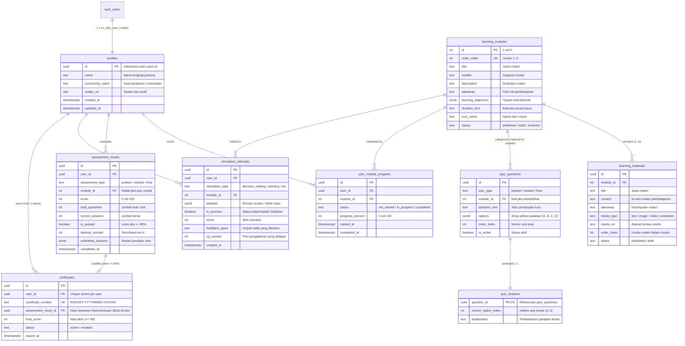
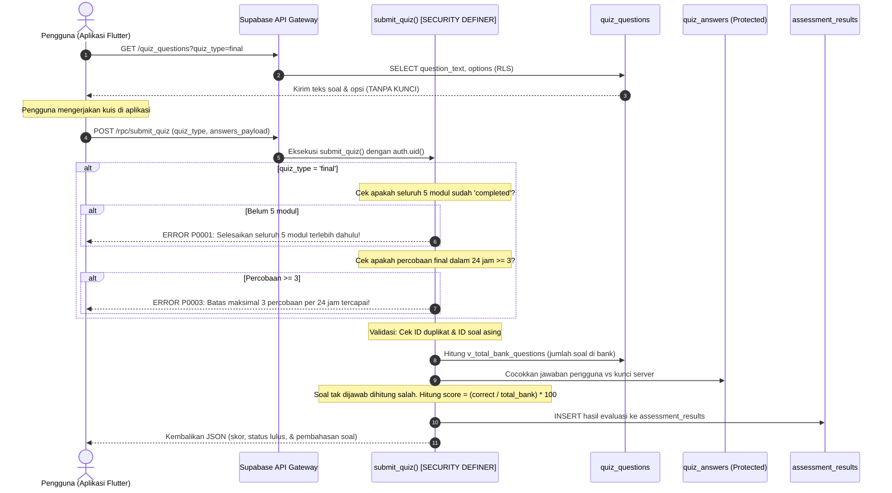
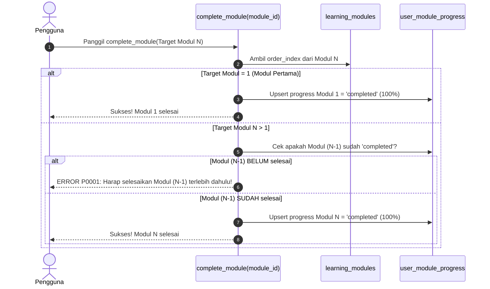
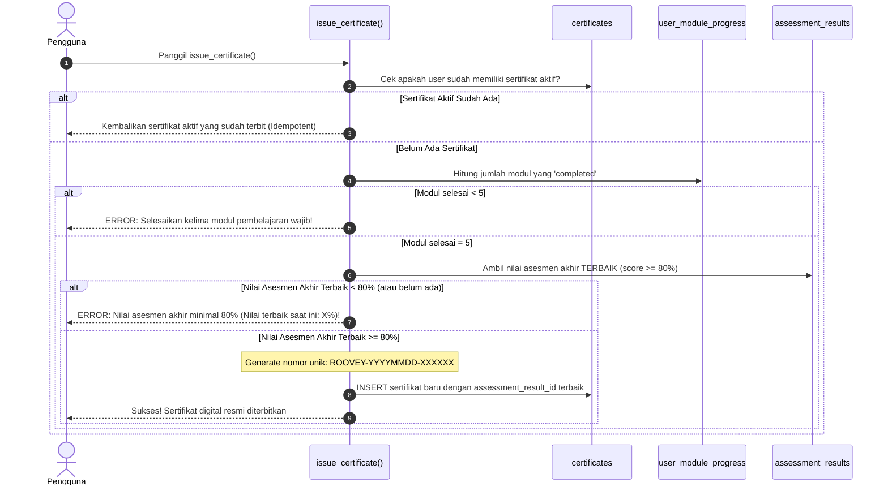

# Dokumentasi Perancangan Backend Supabase: RooveyLearn

> **Status Dokumen**: Selesai Dirancang & Direview (Sprint 2a)  
> **Source of Truth**: [`PROPOSAL_ROOVEYLEARN.md`](../PROPOSAL%20ROOVEYLEARN.md) (Bab 3.4 & 2.4), [`AUDIT_ROOVEYLEARN.md`](../AUDIT_ROOVEYLEARN.md)  
> **Target Platform**: Supabase (PostgreSQL 15+, Supabase Auth, Row Level Security)  

---

## 1. Ringkasan Arsitektur & Prinsip Keamanan

Perancangan backend Supabase untuk **RooveyLearn** dirancang untuk mentransformasi prototipe lokal menjadi platform digital berbasis cloud yang andal, aman, dan mematuhi spesifikasi akademis.

### Prinsip Utama yang Diterapkan:
1. **Zero Client Trust untuk Logika Kelulusan**: Klien tidak memiliki hak untuk melakukan `INSERT` atau `UPDATE` langsung ke tabel hasil evaluasi (`assessment_results`) maupun sertifikat (`certificates`). Evaluasi skor, penentuan kelulusan (ambang $\ge 80\%$), dan penerbitan nomor sertifikat dilakukan 100% di server melalui **PostgreSQL Stored Procedures (RPC)** bertanda `SECURITY DEFINER` dengan parameter `search_path` terkunci (`public, pg_temp`).
2. **Perlindungan Kunci Jawaban Kuis (Rule 3 & P0-02)**: Kunci jawaban (`correct_option_index`) dan pembahasan (`explanation`) tidak disimpan pada tabel yang bisa di-`SELECT` oleh klien. Kami memisahkannya ke tabel terisolasi `quiz_answers` yang tidak memiliki policy `SELECT` untuk role `anon` maupun `authenticated`. Klien hanya menerima pembahasan **setelah** mengirimkan jawaban melalui RPC `submit_quiz()`.
3. **Penegakan Alur Belajar Bertahap (Rule 7)**: Penyelesaian modul diatur oleh RPC `complete_module(module_id)` yang secara ketat memverifikasi bahwa modul $(N-1)$ telah selesai sebelum modul $N$ dapat ditandai `completed`.
4. **Dukungan Mode Tamu (Guest Mode)**: Pengguna tanpa akun (role `anon`) tetap diberikan akses baca (`SELECT`) terhadap katalog modul (`learning_modules`) dan materi bacaan (`learning_materials`) yang berstatus `published`.

---

## 2. Diagram Relasi Entitas (ERD)

---

## 3. Kamus Data & Spesifikasi Tabel

### 3.1 `profiles`
*Menyimpan data identitas pengguna lokal/pesisir yang terhubung dengan akun otentikasi Supabase.*
- `id` (UUID, PK): Menunjuk langsung ke `auth.users(id)` dengan opsi `ON DELETE CASCADE`.
- `name` (TEXT, NOT NULL): Nama lengkap peserta yang akan dicetak pada sertifikat kelulusan.
- `community_name` (TEXT, NULLABLE): Kelompok pelestari, pokdarwis, atau desa pesisir peserta.
- `avatar_url` (TEXT, NULLABLE): Alamat URL gambar avatar jika diunggah ke storage.
- `created_at` / `updated_at` (TIMESTAMPTZ, NOT NULL): Waktu pembuatan dan pembaruan profil.

### 3.2 `learning_modules`
*Katalog 5 modul utama konservasi mangrove sesuai proposal.*
- `id` (INT, PK): ID numerik modul (1, 2, 3, 4, 5).
- `order_index` (INT, UNIQUE, NOT NULL): Nomor urut penyajian pembelajaran (1 s/d 5).
- `title` (TEXT, NOT NULL): Judul resmi modul (contoh: "Kenali Mangrove").
- `subtitle` (TEXT, NULLABLE): Subjudul tema materi.
- `description` (TEXT, NOT NULL): Ringkasan kurikulum modul.
- `takeaway` (TEXT, NULLABLE): Pesan inti yang harus diingat peserta.
- `learning_objectives` (JSONB, NOT NULL): Sasaran instruksional dalam format JSON array.
- `duration_text` (TEXT, NOT NULL): Perkiraan waktu baca (contoh: "5 menit").
- `icon_name` (TEXT, NULLABLE): Pengenal ikon Material Flutter (contoh: `spa_rounded`).
- `status` (TEXT, NOT NULL): Status publikasi (`draft`, `published`, `archived`).

### 3.3 `learning_materials`
*Materi bacaan terstruktur (teks, media pendukung) per modul.*
- `id` (UUID, PK): Pengenal unik materi.
- `module_id` (INT, FK, NOT NULL): Terhubung ke `learning_modules(id)` (`ON DELETE CASCADE`).
- `title` (TEXT, NOT NULL): Judul topik materi di dalam modul.
- `content` (TEXT, NOT NULL): Isi konten lengkap materi pembelajaran.
- `takeaway` (TEXT, NULLABLE): Ringkasan penutup bab.
- `media_type` (TEXT, NOT NULL): Jenis media (`text`, `image`, `video`, `animation`).
- `media_url` (TEXT, NULLABLE): URL berkas media.
- `order_index` (INT, NOT NULL): Urutan bab di dalam modul (Unique constraint per module).
- `status` (TEXT, NOT NULL): Status tayang (`published`, `draft`).

### 3.4 `quiz_questions`
*Bank soal kuis untuk pre-test, kuis modul, dan asesmen akhir (tidak memuat kunci).*
- `id` (UUID, PK): Pengenal unik butir soal.
- `quiz_type` (TEXT, NOT NULL): Kategori paket soal:
  - `'pretest'`: Soal asesmen awal diagnostik.
  - `'module'`: Soal kuis evaluasi materi per modul (`module_id` wajib ada).
  - `'final'`: Soal post-test / asesmen akhir kelulusan program.
- `module_id` (INT, FK, NULLABLE): Relasi ke `learning_modules(id)` jika kuis modul.
- `question_text` (TEXT, NOT NULL): Teks kalimat pertanyaan.
- `options` (JSONB, NOT NULL): Array opsi jawaban berupa teks `["Opsi A", "Opsi B", "Opsi C", "Opsi D"]`.
- `order_index` (INT, NOT NULL): Urutan tampil pertanyaan.
- `is_active` (BOOLEAN, NOT NULL): Flag aktif/nonaktifnya soal.

### 3.5 `quiz_answers` *(Tabel Khusus Keamanan / Protected)*
*Tabel pelindung kunci jawaban dan pembahasan ilmiah. Terisolasi dari akses REST klien.*
> **Alasan & Justifikasi Desain**: Memisahkan kolom kunci jawaban dari `quiz_questions` menjamin bahwa query apa pun yang dilakukan oleh klien (`supabase.from('quiz_questions').select('*')`) secara fisik **mustahil** membocorkan jawaban benar. PostgREST tidak mengizinkan role `anon` maupun `authenticated` membaca tabel ini (`REVOKE ALL`). Hanya prosedur penilaian `submit_quiz()` di database yang dapat membacanya.
- `question_id` (UUID, PK, FK): Terhubung 1:1 ke `quiz_questions(id)` (`ON DELETE CASCADE`).
- `correct_option_index` (INT, NOT NULL): Indeks jawaban benar (0, 1, 2, atau 3).
- `explanation` (TEXT, NOT NULL): Uraian penjelasan mengapa jawaban tersebut benar.

### 3.6 `user_module_progress`
*Pencatatan perkembangan belajar tiap modul secara berurutan.*
- `id` (UUID, PK): Pengenal unik riwayat progres.
- `user_id` (UUID, FK, NOT NULL): ID peserta didik (`profiles.id`).
- `module_id` (INT, FK, NOT NULL): ID modul pembelajaran.
- `status` (TEXT, NOT NULL): `'not_started'`, `'in_progress'`, atau `'completed'`.
- `progress_percent` (INT, NOT NULL): Persentase capaian belajar ($0 - 100\%$).
- `started_at` (TIMESTAMPTZ, NOT NULL): Waktu modul mulai dibuka.
- `completed_at` (TIMESTAMPTZ, NULLABLE): Waktu modul diselesaikan secara resmi.
- *Unique Constraint*: `(user_id, module_id)`.
- *Integritas Kunci (Poin f)*: Dilindungi trigger `protect_module_progress_keys()` agar `user_id` dan `module_id` tidak dapat dimutasi pada operasi `UPDATE`.

### 3.7 `assessment_results`
*Riwayat penilaian kuis dan evaluasi formal.*
- `id` (UUID, PK): Pengenal unik lembar hasil evaluasi.
- `user_id` (UUID, FK, NOT NULL): ID peserta didik.
- `assessment_type` (TEXT, NOT NULL): `'pretest'`, `'module'`, atau `'final'`.
- `module_id` (INT, FK, NULLABLE): Modul terkait jika bertipe kuis modul.
- `score` (INT, NOT NULL): Skor hasil akhir ($0 - 100$). Dihitung proporsional terhadap total soal di bank.
- `total_questions` (INT, NOT NULL): Total soal yang tersedia di bank untuk kuis terkait.
- `correct_answers` (INT, NOT NULL): Jumlah soal yang dijawab benar.
- `is_passed` (BOOLEAN, NOT NULL): Status kelulusan ($true$ jika skor $\ge 80\%$, pre-test selalu dianggap tuntas).
- `attempt_number` (INT, NOT NULL): Nomor urut percobaan untuk kuis terkait ($1, 2, 3, \dots$).
- `submitted_answers` (JSONB, NOT NULL): Log rekaman jawaban yang dipilih oleh peserta.
- `completed_at` (TIMESTAMPTZ, NOT NULL): Waktu pengiriman evaluasi.

### 3.8 `simulation_attempts`
*Riwayat percobaan simulasi interaktif (pengambilan keputusan, urutan tanam, diagnostik, refraktometer).*
- `id` (UUID, PK): ID log percobaan simulasi.
- `user_id` (UUID, FK, NOT NULL): ID peserta yang mencoba.
- `simulation_type` (TEXT, NOT NULL): Jenis aktivitas (`'decision_making'`, `'planting_sequence'`, `'sequence_diagnostic'`, `'refractometer_calibration'`).
- `module_id` (INT, FK, NULLABLE): Modul yang menaungi aktivitas tersebut.
- `payload` (JSONB, NOT NULL): Detail langkah, urutan yang disusun, atau nilai kalibrasi yang diuji.
- `is_success` (BOOLEAN, NOT NULL): Apakah hasil simulasi sesuai prosedur yang benar.
- `score` (INT, NULLABLE): Nilai skor simulasi jika ada ($0 - 100$).
- `feedback_given` (TEXT, NULLABLE): Umpan balik yang ditampilkan kepada pengguna.
- `xp_earned` (INT, NOT NULL): Poin pengalaman yang didapatkan pengguna.
- `created_at` (TIMESTAMPTZ, NOT NULL): Waktu percobaan dilakukan.

### 3.9 `certificates`
*Penyimpanan sertifikat digital resmi yang terverifikasi server.*
- `id` (UUID, PK): Pengenal unik sertifikat.
- `user_id` (UUID, FK, NOT NULL): ID pemilik sertifikat.
- `certificate_number` (TEXT, UNIQUE, NOT NULL): Nomor unik sertifikat (`ROOVEY-YYYYMMDD-XXXXXX`).
- `assessment_result_id` (UUID, FK, NOT NULL): Terhubung ke lembar hasil asesmen akhir **terbaik** yang memenuhi syarat (Keputusan 1).
- `final_score` (INT, NOT NULL): Nilai akhir kelulusan ($\ge 80$).
- `status` (TEXT, NOT NULL): `'active'` atau `'revoked'`.
- `issued_at` (TIMESTAMPTZ, NOT NULL): Waktu resmi sertifikat diterbitkan.
- *Index Khusus*: `CREATE UNIQUE INDEX unique_active_user_certificate ON certificates(user_id) WHERE (status = 'active');` (Menjamin maksimal 1 sertifikat aktif per peserta).

---

## 4. Matriks Akses Data (Row Level Security)

Tabel berikut mendefinisikan secara eksplisit hak akses per operasi (CRUD) untuk masing-masing role:
- **`anon`**: Pengguna tamu (belum login / Mode Tamu).
- **`authenticated`**: Pengguna yang telah login dengan token JWT Supabase.
- **`Server / RPC`**: Prosedur database bertanda `SECURITY DEFINER` (dijalankan dengan hak pemilik schema/postgres).

| Nama Tabel | SELECT | INSERT | UPDATE | DELETE | Keterangan Aturan RLS |
|---|---|---|---|---|---|
| `profiles` | `authenticated` (milik sendiri) | `authenticated` (milik sendiri / via Trigger) | `authenticated` (milik sendiri) | `authenticated` (milik sendiri) | Anon tidak bisa melihat profil pengguna lain. |
| `learning_modules` | `anon`, `authenticated` (published) | Ditolak | Ditolak | Ditolak | Hanya service_role/admin yang dapat mengelola modul. |
| `learning_materials` | `anon`, `authenticated` (published) | Ditolak | Ditolak | Ditolak | Mode tamu dapat membaca seluruh materi terbuka. |
| `quiz_questions` | `anon`, `authenticated` (active) | Ditolak | Ditolak | Ditolak | Hanya menampilkan soal dan opsi, tanpa kunci. |
| `quiz_answers` | **DITOLAK SEMUA** | Ditolak | Ditolak | Ditolak | Terisolasi total dari PostgREST. Hanya dibaca RPC server. |
| `user_module_progress` | `authenticated` (milik sendiri) | `authenticated` (status != 'completed') | `authenticated` (status != 'completed') | `authenticated` (milik sendiri) | Klien dilarang mengubah status jadi 'completed' langsung. User/Module ID immutable. |
| `assessment_results` | `authenticated` (milik sendiri) | **DITOLAK (Hanya RPC)** | Ditolak | Ditolak | Klien tidak bisa memalsukan hasil kuis via REST API. |
| `simulation_attempts` | `authenticated` (milik sendiri) | `authenticated` (milik sendiri) | Ditolak | Ditolak | Log simulasi bersifat *append-only* (immutable audit). |
| `certificates` | `authenticated` (milik sendiri) | **DITOLAK (Hanya RPC)** | Ditolak | Ditolak | Penerbitan hanya lewat validasi ketat `issue_certificate()`. |

---

## 5. Matriks Hak Eksekusi Prosedur (RPC Function Privileges - Poin a)

Seluruh fungsi yang mengubah data sensitif dibuat dengan `SECURITY DEFINER` dan hak eksekusinya dibatasi secara ketat:

| Nama Fungsi | Return Type | Role `anon` | Role `authenticated` | Role `PUBLIC` | Parameter `search_path` |
|---|---|---|---|---|---|
| `handle_new_user()` | `TRIGGER` | **Ditolak** | **Ditolak** | **Ditolak** | `public, pg_temp` |
| `handle_updated_at()` | `TRIGGER` | **Ditolak** | **Ditolak** | **Ditolak** | `public, pg_temp` |
| `protect_module_progress_keys()` | `TRIGGER` | **Ditolak** | **Ditolak** | **Ditolak** | `public, pg_temp` |
| `complete_module(p_module_id)` | `JSONB` | **Ditolak** | **DIIZINKAN (GRANT)** | **Ditolak** | `public, pg_temp` |
| `submit_quiz(p_quiz_type, ...)` | `JSONB` | **Ditolak** | **DIIZINKAN (GRANT)** | **Ditolak** | `public, pg_temp` |
| `issue_certificate()` | `JSONB` | **Ditolak** | **DIIZINKAN (GRANT)** | **Ditolak** | `public, pg_temp` |
| `verify_certificate(p_cert_number)` | `JSONB` | **DIIZINKAN** | **DIIZINKAN** | **Ditolak** | `public, pg_temp` |

---

## 6. Alur Logika Server (RPC Workflows)

### 6.1 Alur Penilaian Kuis Terisolasi (`submit_quiz`)
Mencegah kecurangan, menghitung skor dari total soal di bank, menegakkan prasyarat 5 modul untuk final kuis, dan menerapkan rate limit 3 percobaan per 24 jam.

### 6.2 Alur Penegakan Urutan Modul (`complete_module`)
Menjamin pengguna tidak dapat melompati modul secara acak.

### 6.3 Alur Penerbitan Sertifikat Digital (`issue_certificate`)
Memverifikasi ketiga syarat akademis di sisi server dan mencatat riwayat asesmen terbaik.

---

## 7. Catatan Konfigurasi Supabase Dashboard & Keputusan Produk

Berdasarkan keputusan pemilik proyek, berikut panduan konfigurasi yang harus diatur pada Dashboard Supabase saat setup proyek:

### 7.1 Konfigurasi Supabase Auth: Nonaktifkan Konfirmasi Email (Keputusan 2)
- **Menu**: `Authentication` $\rightarrow$ `Providers` $\rightarrow$ `Email`.
- **Pengaturan**: **Matikan (*Disable*) toggle "Confirm email"**.
- **Tujuan**: Memungkinkan masyarakat pesisir langsung masuk (*auto-confirm*) dan memulai pembelajaran setelah mendaftar tanpa hambatan konfirmasi via email eksternal.
- **Risiko Keamanan & Mitigasi**:
  - *Risiko*: Pengguna dapat mendaftarkan alamat email sembarang atau salah ketik.
  - *Mitigasi*: Akun dibatasi untuk kegiatan pembelajaran lokal; tidak ada transaksi finansial. Jika di masa depan diperlukan pemulihan kata sandi atau pengiriman sertifikat resmi via email, verifikasi email dapat diaktifkan kembali secara bertahap.

### 7.2 Status Fitur Tambahan:
- **Forgot Password (Keputusan 3)**: Ditunda (*postponed*). Belum diintegrasikan ke alur aplikasi mobile pada fase ini.
- **Verifikasi Publik Sertifikat (Keputusan 4)**: Fungsi `verify_certificate(cert_number)` dipertahankan untuk pihak luar, namun hasil kembaliannya dibatasi ketat hanya pada informasi publik:
  - `certificate_number`
  - `participant_name`
  - `program_name` ("Dasar Pengelolaan Mangrove")
  - `issued_at`
  - `status` ('active')
  - *Data privat seperti `user_id`, `email`, dan nilai numerik ujian sengaja TIDAK dikembalikan.*

---

## 8. Rincian Berkas Migrasi Database

1. [`supabase/migrations/20261017000001_create_core_schema.sql`](file:///home/aladlhusodriniwrad/development/rooveylearn_flutter/supabase/migrations/20261017000001_create_core_schema.sql): 8 tabel utama, 1 tabel terproteksi `quiz_answers`, dan seluruh indeks performa.
2. [`supabase/migrations/20261017000002_enable_rls_and_policies.sql`](file:///home/aladlhusodriniwrad/development/rooveylearn_flutter/supabase/migrations/20261017000002_enable_rls_and_policies.sql): Kebijakan RLS eksplisit per operasi, proteksi mutasi key `user_module_progress`.
3. [`supabase/migrations/20261017000003_create_rpc_and_triggers.sql`](file:///home/aladlhusodriniwrad/development/rooveylearn_flutter/supabase/migrations/20261017000003_create_rpc_and_triggers.sql): Triggers, RPC `complete_module()`, `submit_quiz()`, `issue_certificate()`, `verify_certificate()`, dan penarikan/pemberian hak eksekusi fungsi (`REVOKE`/`GRANT`).
4. [`supabase/migrations/20261017000004_seed_initial_data.sql`](file:///home/aladlhusodriniwrad/development/rooveylearn_flutter/supabase/migrations/20261017000004_seed_initial_data.sql): Seed data modul 1-5, materi, dan 5 butir soal kuis akhir asli.
5. [`supabase/tests/rls_verification.sql`](file:///home/aladlhusodriniwrad/development/rooveylearn_flutter/supabase/tests/rls_verification.sql): Suite pengujian 9 skenario keamanan mandiri di SQL Editor.
