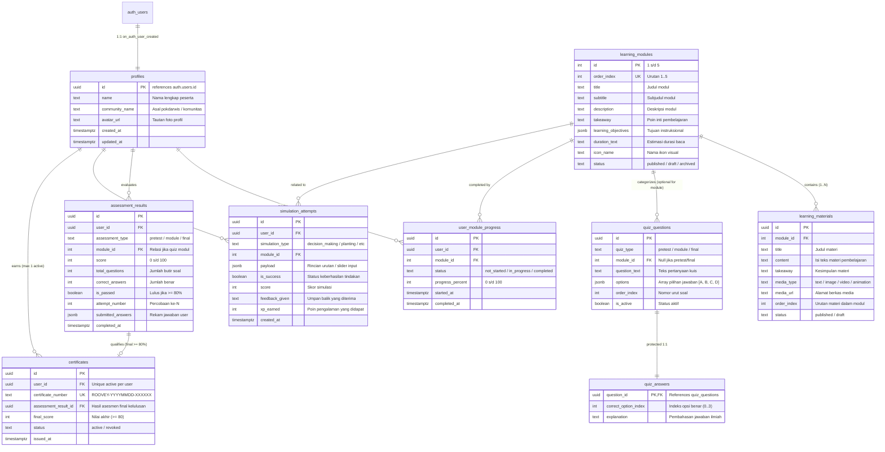
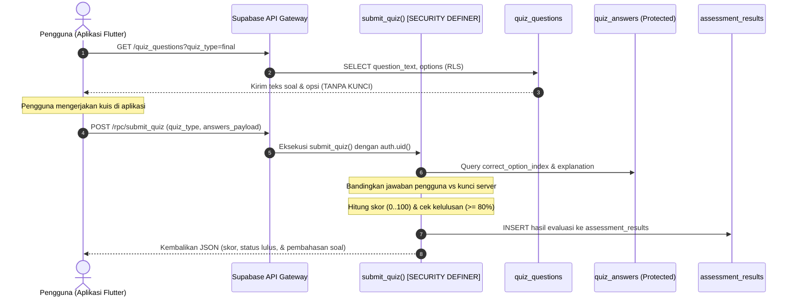
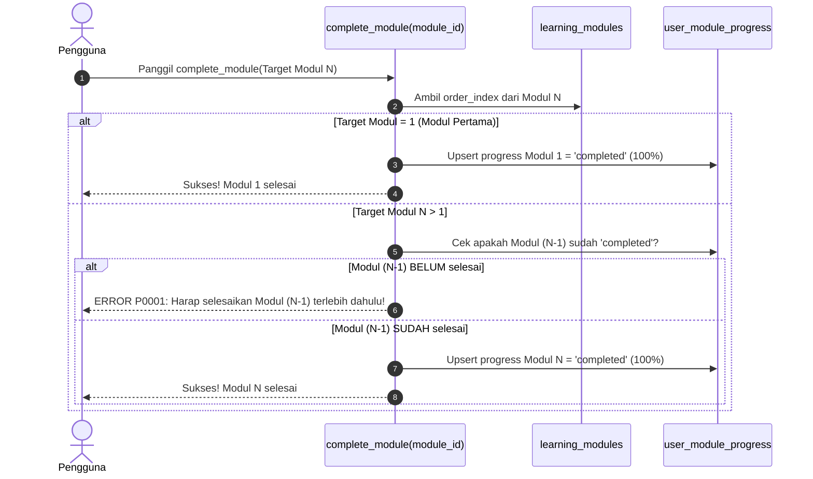
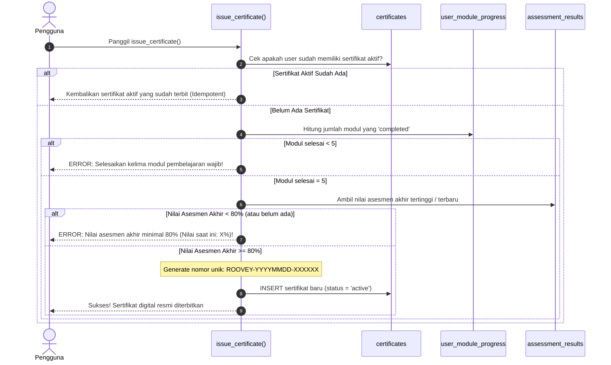

# Dokumentasi Perancangan Backend Supabase: RooveyLearn

> **Status Dokumen**: Selesai Dirancang (Sprint 2a)  
> **Source of Truth**: [`PROPOSAL_ROOVEYLEARN.md`](../PROPOSAL%20ROOVEYLEARN.md) (Bab 3.4 & 2.4), [`AUDIT_ROOVEYLEARN.md`](../AUDIT_ROOVEYLEARN.md)  
> **Target Platform**: Supabase (PostgreSQL 15+, Supabase Auth, Row Level Security)  

---

## 1. Ringkasan Arsitektur & Prinsip Keamanan

Perancangan backend Supabase untuk **RooveyLearn** dirancang untuk mentransformasi prototipe lokal menjadi platform digital berbasis cloud yang andal, aman, dan mematuhi spesifikasi akademis.

### Prinsip Utama yang Diterapkan:
1. **Zero Client Trust untuk Logika Kelulusan**: Klien tidak memiliki hak untuk melakukan `INSERT` atau `UPDATE` langsung ke tabel hasil evaluasi (`assessment_results`) maupun sertifikat (`certificates`). Evaluasi skor, penentuan kelulusan (ambang $\ge 80\%$), dan penerbitan nomor sertifikat dilakukan 100% di server melalui **PostgreSQL Stored Procedures (RPC)** bertanda `SECURITY DEFINER` dengan parameter `search_path` terkunci (`public, pg_temp`).
2. **Perlindungan Kunci Jawaban Kuis (Rule 3 & P0-02)**: Kunci jawaban (`correct_option_index`) dan pembahasan (`explanation`) tidak disimpan pada tabel yang bisa di-`SELECT` oleh klien. Kami memisahkannya ke tabel terisolasi `quiz_answers` yang tidak memiliki policy `SELECT` untuk role `anon` maupun `authenticated`. Klien hanya menerima pembahasan **setelah** mengirimkan jawaban melalui RPC `submit_quiz()`.
3. **Penegakan Alur Belajar Bertahap (Rule 7)**: Penyelesaian modul diatur oleh RPC `complete_module(module_id)` yang secara ketat memverifikasi bahwa modul $(N-1)$ telah selesai sebelum modul $N$ dapat ditandai `completed`.
4. **Dukungan Mode Tamu (Guest Mode)**: Pengguna tanpa akun (role `anon`) tetap diberikan akses baca (`SELECT`) terhadap katalog modul (`learning_modules`) dan materi bacaan (`learning_materials`) yang berstatus `published`.

---

## 2. Diagram Relasi Entitas (ERD)

---

## 3. Kamus Data & Spesifikasi Tabel

### 3.1 `profiles`
*Menyimpan data identitas pengguna lokal/pesisir yang terhubung dengan akun otentikasi Supabase.*
- `id` (UUID, PK): Menunjuk langsung ke `auth.users(id)` dengan opsi `ON DELETE CASCADE`.
- `name` (TEXT, NOT NULL): Nama lengkap peserta yang akan dicetak pada sertifikat kelulusan.
- `community_name` (TEXT, NULLABLE): Kelompok pelestari, pokdarwis, atau desa pesisir peserta.
- `avatar_url` (TEXT, NULLABLE): Alamat URL gambar avatar jika diunggah ke storage.
- `created_at` / `updated_at` (TIMESTAMPTZ, NOT NULL): Waktu pembuatan dan pembaruan profil.

### 3.2 `learning_modules`
*Katalog 5 modul utama konservasi mangrove sesuai proposal.*
- `id` (INT, PK): ID numerik modul (1, 2, 3, 4, 5).
- `order_index` (INT, UNIQUE, NOT NULL): Nomor urut penyajian pembelajaran (1 s/d 5).
- `title` (TEXT, NOT NULL): Judul resmi modul (contoh: "Kenali Mangrove").
- `subtitle` (TEXT, NULLABLE): Subjudul tema materi.
- `description` (TEXT, NOT NULL): Ringkasan kurikulum modul.
- `takeaway` (TEXT, NULLABLE): Pesan inti yang harus diingat peserta.
- `learning_objectives` (JSONB, NOT NULL): Sasaran instruksional dalam format JSON array.
- `duration_text` (TEXT, NOT NULL): Perkiraan waktu baca (contoh: "5 menit").
- `icon_name` (TEXT, NULLABLE): Pengenal ikon Material Flutter (contoh: `spa_rounded`).
- `status` (TEXT, NOT NULL): Status publikasi (`draft`, `published`, `archived`).

### 3.3 `learning_materials`
*Materi bacaan terstruktur (teks, media pendukung) per modul.*
- `id` (UUID, PK): Pengenal unik materi.
- `module_id` (INT, FK, NOT NULL): Terhubung ke `learning_modules(id)` (`ON DELETE CASCADE`).
- `title` (TEXT, NOT NULL): Judul topik materi di dalam modul.
- `content` (TEXT, NOT NULL): Isi konten lengkap materi pembelajaran.
- `takeaway` (TEXT, NULLABLE): Ringkasan penutup bab.
- `media_type` (TEXT, NOT NULL): Jenis media (`text`, `image`, `video`, `animation`).
- `media_url` (TEXT, NULLABLE): URL berkas media (misalnya dari Supabase Storage atau CDN).
- `order_index` (INT, NOT NULL): Urutan bab di dalam modul (Unique constraint per module).
- `status` (TEXT, NOT NULL): Status tayang (`published`, `draft`).

### 3.4 `quiz_questions`
*Bank soal kuis untuk pre-test, kuis modul, dan asesmen akhir (tidak memuat kunci).*
- `id` (UUID, PK): Pengenal unik butir soal.
- `quiz_type` (TEXT, NOT NULL): Kategori paket soal:
  - `'pretest'`: Soal asesmen awal diagnostik.
  - `'module'`: Soal kuis evaluasi materi per modul (`module_id` wajib ada).
  - `'final'`: Soal post-test / asesmen akhir kelulusan program.
- `module_id` (INT, FK, NULLABLE): Relasi ke `learning_modules(id)` jika kuis modul.
- `question_text` (TEXT, NOT NULL): Teks kalimat pertanyaan.
- `options` (JSONB, NOT NULL): Array opsi jawaban berupa teks `["Opsi A", "Opsi B", "Opsi C", "Opsi D"]`.
- `order_index` (INT, NOT NULL): Urutan tampil pertanyaan.
- `is_active` (BOOLEAN, NOT NULL): Flag aktif/nonaktifnya soal.

### 3.5 `quiz_answers` *(Tabel Khusus Keamanan / Protected)*
*Tabel pelindung kunci jawaban dan pembahasan ilmiah. Terisolasi dari akses REST klien.*
> **Alasan & Justifikasi Desain**: Memisahkan kolom kunci jawaban dari `quiz_questions` menjamin bahwa query apa pun yang dilakukan oleh klien (`supabase.from('quiz_questions').select('*')`) secara fisik **mustahil** membocorkan jawaban benar. PostgREST tidak mengizinkan role `anon` maupun `authenticated` membaca tabel ini. Hanya prosedur penilaian `submit_quiz()` di database yang dapat membacanya.
- `question_id` (UUID, PK, FK): Terhubung 1:1 ke `quiz_questions(id)` (`ON DELETE CASCADE`).
- `correct_option_index` (INT, NOT NULL): Indeks jawaban benar (0, 1, 2, atau 3).
- `explanation` (TEXT, NOT NULL): Uraian penjelasan mengapa jawaban tersebut benar.

### 3.6 `user_module_progress`
*Pencatatan perkembangan belajar tiap modul secara berurutan.*
- `id` (UUID, PK): Pengenal unik riwayat progres.
- `user_id` (UUID, FK, NOT NULL): ID peserta didik (`profiles.id`).
- `module_id` (INT, FK, NOT NULL): ID modul pembelajaran.
- `status` (TEXT, NOT NULL): `'not_started'`, `'in_progress'`, atau `'completed'`.
- `progress_percent` (INT, NOT NULL): Persentase capaian belajar ($0 - 100\%$).
- `started_at` (TIMESTAMPTZ, NOT NULL): Waktu modul mulai dibuka.
- `completed_at` (TIMESTAMPTZ, NULLABLE): Waktu modul diselesaikan secara resmi.
- *Unique Constraint*: `(user_id, module_id)`.

### 3.7 `assessment_results`
*Riwayat penilaian kuis dan evaluasi formal.*
- `id` (UUID, PK): Pengenal unik lembar hasil evaluasi.
- `user_id` (UUID, FK, NOT NULL): ID peserta didik.
- `assessment_type` (TEXT, NOT NULL): `'pretest'`, `'module'`, atau `'final'`.
- `module_id` (INT, FK, NULLABLE): Modul terkait jika bertipe kuis modul.
- `score` (INT, NOT NULL): Skor hasil akhir ($0 - 100$).
- `total_questions` (INT, NOT NULL): Total soal yang dijawab.
- `correct_answers` (INT, NOT NULL): Jumlah soal yang dijawab benar.
- `is_passed` (BOOLEAN, NOT NULL): Status kelulusan ($true$ jika skor $\ge 80\%$, pre-test selalu dianggap tuntas).
- `attempt_number` (INT, NOT NULL): Nomor urut percobaan untuk kuis terkait ($1, 2, 3, \dots$).
- `submitted_answers` (JSONB, NOT NULL): Log rekaman jawaban yang dipilih oleh peserta.
- `completed_at` (TIMESTAMPTZ, NOT NULL): Waktu pengiriman evaluasi.

### 3.8 `simulation_attempts`
*Riwayat percobaan simulasi interaktif (pengambilan keputusan, urutan tanam, diagnostik, refraktometer).*
- `id` (UUID, PK): ID log percobaan simulasi.
- `user_id` (UUID, FK, NOT NULL): ID peserta yang mencoba.
- `simulation_type` (TEXT, NOT NULL): Jenis aktivitas (`'decision_making'`, `'planting_sequence'`, `'sequence_diagnostic'`, `'refractometer_calibration'`).
- `module_id` (INT, FK, NULLABLE): Modul yang menaungi aktivitas tersebut.
- `payload` (JSONB, NOT NULL): Detail langkah, urutan yang disusun, atau nilai kalibrasi yang diuji.
- `is_success` (BOOLEAN, NOT NULL): Apakah hasil simulasi sesuai prosedur yang benar.
- `score` (INT, NULLABLE): Nilai skor simulasi jika ada ($0 - 100$).
- `feedback_given` (TEXT, NULLABLE): Umpan balik yang ditampilkan kepada pengguna.
- `xp_earned` (INT, NOT NULL): Poin pengalaman yang didapatkan pengguna.
- `created_at` (TIMESTAMPTZ, NOT NULL): Waktu percobaan dilakukan.

### 3.9 `certificates`
*Penyimpanan sertifikat digital resmi yang terverifikasi server.*
- `id` (UUID, PK): Pengenal unik sertifikat.
- `user_id` (UUID, FK, NOT NULL): ID pemilik sertifikat.
- `certificate_number` (TEXT, UNIQUE, NOT NULL): Nomor unik sertifikat (`ROOVEY-YYYYMMDD-XXXXXX`).
- `assessment_result_id` (UUID, FK, NOT NULL): Kaitan ke hasil asesmen akhir yang memenuhi syarat.
- `final_score` (INT, NOT NULL): Nilai akhir kelulusan ($\ge 80$).
- `status` (TEXT, NOT NULL): `'active'` atau `'revoked'`.
- `issued_at` (TIMESTAMPTZ, NOT NULL): Waktu resmi sertifikat diterbitkan.
- *Index Khusus*: `CREATE UNIQUE INDEX unique_active_user_certificate ON certificates(user_id) WHERE (status = 'active');` (Menjamin maksimal 1 sertifikat aktif per peserta).

---

## 4. Matriks Akses Data (Row Level Security)

Tabel berikut mendefinisikan secara eksplisit hak akses per operasi (CRUD) untuk masing-masing role:
- **`anon`**: Pengguna tamu (belum login / Mode Tamu).
- **`authenticated`**: Pengguna yang telah login dengan token JWT Supabase.
- **`Server / RPC`**: Prosedur database bertanda `SECURITY DEFINER` (dijalankan dengan hak pemilik schema/postgres).

| Nama Tabel | SELECT | INSERT | UPDATE | DELETE | Keterangan Aturan RLS |
|---|---|---|---|---|---|
| `profiles` | `authenticated` (milik sendiri) | `authenticated` (milik sendiri / via Trigger) | `authenticated` (milik sendiri) | `authenticated` (milik sendiri) | Anon tidak bisa melihat profil pengguna lain. |
| `learning_modules` | `anon`, `authenticated` (published) | Ditolak | Ditolak | Ditolak | Hanya service_role/admin yang dapat mengelola modul. |
| `learning_materials` | `anon`, `authenticated` (published) | Ditolak | Ditolak | Ditolak | Mode tamu dapat membaca seluruh materi terbuka. |
| `quiz_questions` | `anon`, `authenticated` (active) | Ditolak | Ditolak | Ditolak | Hanya menampilkan soal dan opsi, tanpa kunci. |
| `quiz_answers` | **DITOLAK SEMUA** | Ditolak | Ditolak | Ditolak | Terisolasi total dari PostgREST. Hanya dibaca RPC server. |
| `user_module_progress` | `authenticated` (milik sendiri) | `authenticated` (status != 'completed') | `authenticated` (status != 'completed') | `authenticated` (milik sendiri) | Klien dilarang mengubah status jadi 'completed' langsung. |
| `assessment_results` | `authenticated` (milik sendiri) | **DITOLAK (Hanya RPC)** | Ditolak | Ditolak | Klien tidak bisa memalsukan hasil kuis via REST API. |
| `simulation_attempts` | `authenticated` (milik sendiri) | `authenticated` (milik sendiri) | Ditolak | Ditolak | Log simulasi bersifat *append-only* (immutable audit). |
| `certificates` | `authenticated` (milik sendiri) | **DITOLAK (Hanya RPC)** | Ditolak | Ditolak | Penerbitan hanya lewat validasi ketat `issue_certificate()`. |

---

## 5. Alur Logika Server (RPC Workflows)

### 5.1 Alur Penilaian Kuis Terisolasi (`submit_quiz`)
Mencegah kecurangan dengan melakukan evaluasi dan pemberian umpan balik hanya setelah pengguna mengirimkan lembar jawaban.

### 5.2 Alur Penegakan Urutan Modul (`complete_module`)
Menjamin pengguna tidak dapat melompati modul secara acak.

### 5.3 Alur Penerbitan Sertifikat Digital (`issue_certificate`)
Memverifikasi ketiga syarat akademis di sisi server sebelum nomor sertifikat diterbitkan.

---

## 6. Daftar Asumsi & Pertanyaan Keputusan Desain

Berikut adalah beberapa aspek perancangan yang memerlukan konfirmasi/keputusan strategis dari pemilik proyek sebelum integrasi kode Flutter dijalankan:

1. **Kebijakan Nilai Asesmen Akhir untuk Sertifikat (Terbaik vs. Terakhir)**:
   - *Desain Saat Ini*: Prosedur `issue_certificate()` memeriksa nilai **terbaik** (`ORDER BY score DESC`) yang dicapai oleh pengguna. Jika pengguna pernah memperoleh nilai $85\%$, lalu mencoba lagi dan mendapat $70\%$, hak sertifikatnya tetap sah berdasarkan nilai terbaiknya.
   - *Pertanyaan*: Apakah kebijakan ini disetujui, ataukah harus menggunakan nilai **terakhir** (`ORDER BY completed_at DESC`)?
2. **Konfirmasi Email pada Registrasi Supabase Auth**:
   - Untuk masyarakat pesisir dengan keterbatasan konektivitas dan literasi email, apakah fitur **"Confirm Email"** di Supabase Auth sebaiknya dinonaktifkan (*disabled*) agar peserta dapat langsung belajar setelah registrasi tanpa perlu membuka kotak masuk email?
3. **Mekanisme Lupa Kata Sandi**:
   - Pada aplikasi prototipe lokal, kata sandi yang lupa tidak dapat dipulihkan. Dengan beralih ke Supabase Auth, sistem mendukung *Password Reset Email*. Apakah alur lupa kata sandi via email akan diaktifkan di aplikasi mobile?
4. **Verifikasi Publik Sertifikat**:
   - Kami telah menyertakan fungsi RPC `verify_certificate(cert_number)` yang dapat dipanggil oleh pihak luar (misalnya dinas lingkungan hidup, yayasan konservasi, atau pemindai kode QR) untuk mengecek validitas sertifikat tanpa harus login ke aplikasi. Apakah fitur ini akan dimanfaatkan?
5. **Retensi & Batasan Percobaan Simulasi**:
   - Saat ini tabel `simulation_attempts` mencatat setiap aksi simulasi tanpa batas. Apakah perlu diterapkan batas maksimum percobaan per hari atau batas retensi log?

---

## 7. Rincian Berkas Migrasi Database

Seluruh rancangan backend di atas diwujudkan dalam 4 berkas migrasi SQL berurutan dan 1 berkas verifikasi:

1. [`supabase/migrations/20261017000001_create_core_schema.sql`](file:///home/aladlhusodriniwrad/development/rooveylearn_flutter/supabase/migrations/20261017000001_create_core_schema.sql)
   - Definisi 8 tabel utama + 1 tabel terproteksi `quiz_answers`.
   - Primary key, foreign key cascade, check constraints, dan pembuatan indeks performa.
2. [`supabase/migrations/20261017000002_enable_rls_and_policies.sql`](file:///home/aladlhusodriniwrad/development/rooveylearn_flutter/supabase/migrations/20261017000002_enable_rls_and_policies.sql)
   - Pengaktifan RLS di seluruh tabel.
   - Penulisan kebijakan per operasi (`SELECT`, `INSERT`, `UPDATE`, `DELETE`) secara eksplisit.
   - Isolasi total kunci jawaban dari role klien.
3. [`supabase/migrations/20261017000003_create_rpc_and_triggers.sql`](file:///home/aladlhusodriniwrad/development/rooveylearn_flutter/supabase/migrations/20261017000003_create_rpc_and_triggers.sql)
   - Trigger otomatis `handle_new_user()` saat registrasi akun.
   - Trigger otomatis `handle_updated_at()`.
   - Prosedur aman `complete_module()`, `submit_quiz()`, `issue_certificate()`, dan `verify_certificate()`.
4. [`supabase/migrations/20261017000004_seed_initial_data.sql`](file:///home/aladlhusodriniwrad/development/rooveylearn_flutter/supabase/migrations/20261017000004_seed_initial_data.sql)
   - Seed data 5 modul pembelajaran, materi awal teks, dan 5 butir soal kuis akhir dari kode Flutter asli.
   - Tagging `TODO` untuk bank soal pre-test dan kuis per modul (dijadwalkan pada Sprint 3).
5. [`supabase/tests/rls_verification.sql`](file:///home/aladlhusodriniwrad/development/rooveylearn_flutter/supabase/tests/rls_verification.sql)
   - Script pengujian mandiri 6 skenario keamanan RLS dan RPC di Supabase SQL Editor.
